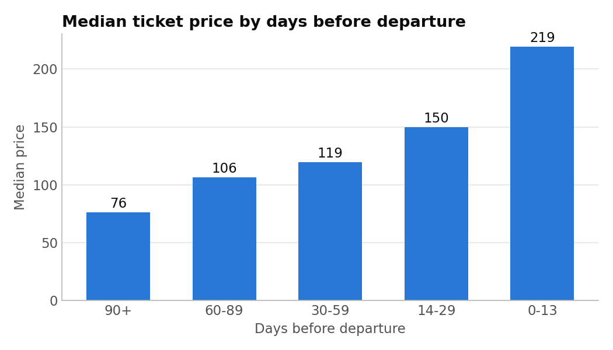
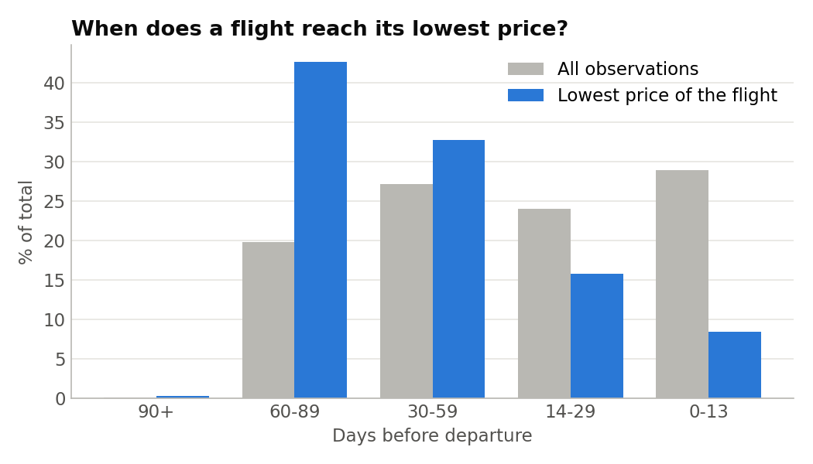
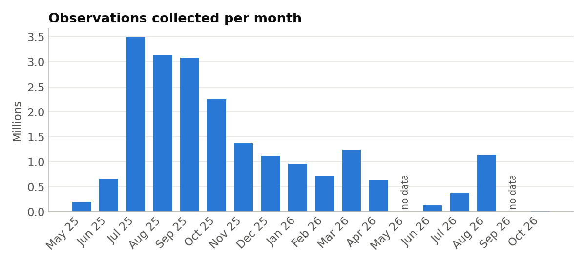

# Flight Prices in SQL

For my main project ([flight-price-prediction](https://github.com/hexus07/flight-price-prediction)) I scraped Google Flights with my own library from May 2025 and trained a model to decide "buy now or wait". The answer there was: waiting by default loses money, and a model can save only a little.

Here I look at the same data with SQL only. Some simpler questions about prices, and also a check of the data itself, because the scraper didn't always work.

Data: ~20M prices for ~2M flights on 1096 routes, between European regions (Baltics, Nordics, Britain, Iberia, Western/Eastern Europe) and US hubs ([Kaggle](https://www.kaggle.com/datasets/daniilchuhai/flights-test)). I used DuckDB because it reads the parquet file directly, no database setup.

## Main things

- buying in the last 2 weeks is about 2x more expensive than 2-3 months before
- 59% of flights got cheaper at some point after I first saw them
- the lowest price is usually 1-3 months before departure
- Google's "Best" flights are usually cheaper than others on the same day
- the scraper missed a lot of days from late 2025, so most of the data is from summer/autumn 2025

## 1. Overview

Query: [01_overview.sql](queries/01_overview.sql)

| observations | flights | routes | airlines | from | to | min price | median price | max price |
|---:|---:|---:|---:|:---|:---|---:|---:|---:|
| 20,496,381 | 1,967,106 | 1,096 | 56 | 2025-05-02 | 2026-10-08 | 10 | 145.02 | 19,345.81 |

Prices go from 10 to 19k. The most expensive ones are long-haul flights a day or two before departure (top one is Air France Paris - San Francisco), so I kept them. But because of them the average is much higher than the median, so I mostly use median.

Query: [01b_obs_per_flight.sql](queries/01b_obs_per_flight.sql)

|   median_obs_per_flight |   avg_obs_per_flight |   flights_seen_once |
|------------------------:|---------------------:|--------------------:|
|                       8 |              10.4196 |              164428 |

A typical flight was seen 8 times. 164k flights were seen only once, and with one price you can't say anything about a price change, so in 3 and 4 I only keep flights with 3+ observations.

## 2. Price vs days before departure

Query: [02_price_by_days_left.sql](queries/02_price_by_days_left.sql)

| bucket   |   avg_price |   median_price |       n |
|:---------|------------:|---------------:|--------:|
| 0-13     |      332.63 |         219.44 | 5911507 |
| 14-29    |      244.13 |         149.7  | 4835604 |
| 30-59    |      199.69 |         119.45 | 5479078 |
| 60-89    |      176.4  |         106.22 | 4248507 |
| 90+      |      181.32 |          76.22 |   21685 |

The closer to departure, the more expensive. Median is ~106 at 60-89 days and ~219 in the last two weeks, so it doubles. This is the same thing I saw in the main project: prices mostly go up, so waiting by default loses money. 90+ has only 21k rows (the scraper rarely looked that far ahead), so I don't really trust it.

## 3. Price drops

For each flight I take the first price I saw (`arg_min` by time) and the lowest price it ever had.

Query: [03_price_drops.sql](queries/03_price_drops.sql)

|   pct_flights_dropped |   avg_drop_pct |
|----------------------:|---------------:|
|                  59.2 |           19.1 |

59% of flights were cheaper at some point than when I first saw them, by 19% on average. Looks like you should always wait, but this is hindsight, you don't know when the drop comes. In the main project waiting by default lost 13-27%.

## 4. When is the lowest price

Query: [04_when_lowest_price.sql](queries/04_when_lowest_price.sql)

| bucket   |   pct_obs |   pct_lowest |
|:---------|----------:|-------------:|
| 0-13     |      28.9 |          8.4 |
| 14-29    |      24   |         15.8 |
| 30-59    |      27.2 |         32.8 |
| 60-89    |      19.8 |         42.7 |
| 90+      |       0.1 |          0.3 |

Lowest price for each flight with `ROW_NUMBER`, then in which days-before bucket it was. I put it next to the share of all observations, because the buckets are different sizes and the scraper didn't cover every day the same, otherwise it's not a fair comparison.

43% of flights had their lowest price 60-89 days before departure, even though only 20% of observations are there. In the last two weeks it's the opposite: 29% of observations, only 8% of minimums. It matches what I saw on single flights in the main project, for example Ryanair Kaunas - Madrid was cheapest around 50-80 days before.

## 5. Cheapest airline on the top routes

Query: [05_cheapest_airline.sql](queries/05_cheapest_airline.sql)

| src   | dst   | cheapest_airline   |   median_price | second_airline   |   second_price |   pct_cheaper |
|:------|:------|:-------------------|---------------:|:-----------------|---------------:|--------------:|
| ORD   | LGA   | Spirit             |          60.35 | United           |          97.91 |          38.4 |
| LHR   | JFK   | Finnair            |         459.73 | JetBlue          |         722.22 |          36.3 |
| SFO   | LAX   | Frontier           |          58.52 | American         |          89.14 |          34.4 |
| LAX   | SFO   | Frontier           |          56.45 | United           |          85.84 |          34.2 |
| ATL   | DFW   | Spirit             |          45.53 | Frontier         |          63.27 |          28   |
| DFW   | ATL   | Spirit             |          45.67 | Frontier         |          62.57 |          27   |
| MAD   | LIS   | Ryanair            |          36.11 | easyJet          |          44.99 |          19.7 |
| LIS   | MAD   | Ryanair            |          39.99 | easyJet          |          49.49 |          19.2 |
| ORD   | ATL   | Spirit             |          55.58 | Frontier         |          63.68 |          12.7 |
| JFK   | LHR   | American           |         244.45 | Delta            |         245.81 |           0.6 |

Top 10 routes by number of flights, median price per airline (only 30+ flights), `RANK` to get the cheapest and `LEAD` to compare with the second one.

Low-cost airlines win: Spirit and Frontier in the US, Ryanair on Madrid - Lisbon, 20-38% cheaper than the next airline. In the main project low-cost airlines also changed their prices much more often than network ones. JFK - LHR is basically a tie (American vs Delta, 0.6%). Finnair on LHR - JFK is weird, only ~37 flights there, probably a codeshare.

## 6. Scraper gaps

The scraper ran on my home PC on a schedule. Until autumn 2025 it worked almost every day, then it started missing days, often running only every 4-8 days. Here I check where the gaps are (`LAG` on days with data) and how much data I got per month.

Query: [06_scraper_gaps.sql](queries/06_scraper_gaps.sql)

| day_before_gap      | day_after_gap       |   gap |
|:--------------------|:--------------------|------:|
| 2026-04-15 | 2026-06-28 |    74 |
| 2026-08-21 | 2026-10-06 |    46 |
| 2026-07-18 | 2026-08-01 |    14 |
| 2026-06-28 | 2026-07-11 |    13 |
| 2026-01-30 | 2026-02-10 |    11 |
| 2026-03-18 | 2026-03-27 |     9 |
| 2026-08-04 | 2026-08-12 |     8 |
| 2025-12-14 | 2025-12-22 |     8 |
| 2026-01-17 | 2026-01-24 |     7 |
| 2025-11-23 | 2025-11-30 |     7 |
| 2026-02-21 | 2026-02-28 |     7 |
| 2026-02-15 | 2026-02-21 |     6 |
| 2026-03-08 | 2026-03-14 |     6 |
| 2025-11-30 | 2025-12-06 |     6 |
| 2026-04-06 | 2026-04-12 |     6 |

Query: [06b_obs_per_month.sql](queries/06b_obs_per_month.sql)

Two big gaps: 74 days (April - June 2026) and 46 days (August - October 2026). In total there is data for 212 days out of 524. So most of the data is from summer and autumn 2025, and sometimes a "price drop" between two observations is weeks apart, not one day. Those were cleaned after.

## 7. Are "Best" flights cheaper?

Google Flights marks some flights as "Best". I wanted to see if they're cheaper or just more convenient. Comparing Best vs others directly is not fair (different routes and dates), so I compare each flight with the average price on the same route on the same day, and keep only route-days that have both.

Query: [07_best_vs_other.sql](queries/07_best_vs_other.sql)

| is_best | avg % diff | median % diff | rows |
|---:|---:|---:|---:|
| 0 | +1.6 | -13.7 | 11,452,960 |
| 1 | -14.2 | -26.4 | 1,298,163 |

Yes, Best flights are cheaper: the median Best flight is 26% below the route-day average, other flights 14% below. Both are negative because a few expensive flights pull the average up. So price matters a lot for Google's "Best", not only duration.
